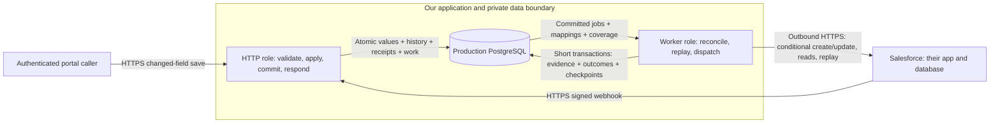

# Phase 3: architecture and durable boundaries

24 November 2026. Read with `data-model.md`, `conflict-rules.md`, and `assumptions.md`. Choose one application codebase with HTTP and worker roles. Roles can share a process for the exercise or run as separate instances against production PostgreSQL. Their correctness boundary is committed database state, never an in-memory queue. No broker, Redis, or additional service is required by a named subproblem.

## 1. Callers and network boundaries



Salesforce initiates inbound webhook requests across the public HTTPS boundary. Our worker initiates outbound Salesforce requests across that same external trust boundary. Portal callers cross an authenticated HTTPS boundary. PostgreSQL is private and accessible only to our roles; Salesforce never writes it directly. HTTP handlers do not make Salesforce calls while applying webhooks or saves. Workers share one outbound budget, including retries, reads, history, and repair calls. Network authentication and upstream capabilities remain provisional contracts, not verified Salesforce features.

## 2. Subproblems and components in build order

| Subproblem | Component and purpose |
|---|---|
| Identify edits and choose current fields without losing history | Pure field-resolution rules from Phase 2, shared by HTTP and worker replay ingestion. |
| Make accepted edits survive restart and prevent concurrent partial decisions | PostgreSQL transaction repository, identity constraints, entity locks, candidates, history, receipts, and durable jobs. |
| Receive externally initiated changes safely | HTTP adapter authenticates/schema-checks and calls the transactional application routine; returns success only after application commit. Detailed inbound policy is Phase 4. |
| Propagate portal changes and necessary repairs despite failures | Worker claims durable work, prepares mutations, calls the conditional record adapter, and persists outcomes. Detailed state transitions and rate pacing are Phase 5. |
| Resolve identity, owners, and parent-before-child creates | Mapping/dependency queries and indexed waiters inside the same repository; blocked work remains visible/durable. |
| Recover missing webhook history without racing stale backlog | Replay adapter and transactional manifest/checkpoint tracking reuse the inbound application routine. Scheduling and coverage barriers are Phase 6. |
| Explain health and required submission | Durable job/receipt/evidence timestamps support later metrics; exactly three primary metrics are selected in Phase 7. |

Database polling finds due work through partial indexes; poll timing and worker capacity must fit the later latency budget. Optional wake-ups can reduce idle latency, but loss of a wake-up cannot lose work. Scale HTTP/worker instances with shared row locks, dispatch slots, and rate budget. Five million records do not require five million concurrent workers.

## 3. Interfaces and what crosses each boundary

These are language-neutral/TypeScript-style design sketches, not implemented endpoints or claims about native Salesforce APIs.

```ts
type Patch = Record<string, string | null>; // validated object-specific allowlist
type SourceEvent = {
  tenantId: string; sourceAccount: string; schemaVersion: number;
  eventId: string; editId?: string; recordId: string;
  objectType: 'Customer' | 'Contact'; operation: 'create' | 'update';
  sourceIncarnation: string; sourceRevision: string; // lossless bigint encoding
  occurredAt: string; actorId: string; actorDisplay?: string;
  changedFields: Patch;
  provenance?: Record<string, { mutationId: string; originalEditId: string }>;
};
type PortalSave = {
  entityId: string; requestKey: string; changedFields: Patch;
}; // actor, time, revision supplied by server, never trusted from body
type SaveResult = {
  acceptedEditId: string; portalRevision: string; occurredAt: string;
  resolvedFields: Patch; winningEditIds: Record<string, string>;
  syncStatus: 'pending' | 'synchronized' | 'blocked';
};
```

Tenant/account authority comes from configured authenticated context and must match the envelope. Source events may carry multiple original edit references for mixed propagated/original fields; a single event-wide actor/version must not overwrite propagated provenance. Transport event identity, original edit identity, mutation identity, and replay cursor are separate concepts. Timestamps normalize to exact millisecond comparison metadata. References in external patches are source IDs translated through mappings, never unsafely treated as canonical UUIDs.

| Interface | Contract |
|---|---|
| `POST /webhooks/salesforce` | Salesforce sends authenticated envelope. Validate bounded body/schema/provenance, atomically apply, return committed receipt/result. Successful duplicate confirms prior commit. Detailed auth/error cases belong to Phase 4. |
| `POST /customers`, `POST /contacts`; `PATCH /…/:entityId` | Authenticated portal caller sends request identity and explicit patch. Create allocates stable UUID reused by retries. Return durable save result after commit, without waiting for Salesforce. A returned winner may differ from the submitted value. |
| `GET /…/:entityId`, `GET /…/:entityId/history?cursor=…` | Tenant-scoped current resolved values/status and paginated immutable edit history. Blocked references are explicitly shown; typed projection alone is insufficient. History pagination uses stable ordering plus edit ID and access control. |
| `applySourceEvent(event, replayManifestEntry?)` | Shared transactional repository routine for webhook and replay; applies facts, candidates, evidence, receipts, repair/dependency intent, and optional manifest completion together. |
| `claimWork(now)`, `prepareMutation(job, epoch)`, `completeAttempt(result)` | Worker exchanges durable IDs, desired versions, lease epoch, exact precondition/provenance, and results through PostgreSQL. No correctness-critical message crosses via process memory. |
| `readRecord(id)`, `readHistoryThrough(id, R)`, `conditionalPatch(id, R, patch, provenance)` | Assumed upstream adapter exposes revision, complete attributable history through R, and atomic precondition failure. Every page/read/write consumes shared request budget. |
| `createOrResolve(externalUuid, mutationId, initialFields)` | Assumed unique creation/idempotency contract returns same remote identity after ambiguous acceptance. An existing result is read/merged before any update; retry must not reinitialize its fields. |
| `replay(partition, cursor, highWater?)` | Assumed stable ordered page/manifest with resumable cursor, retention-gap detection, and explicit completion boundary. No fabricated numeric ordering for opaque cursors. |

Production response/error schemas, auth algorithm, and retry timing are intentionally finalized in Phases 4–5. Interfaces name required semantics now so later flows cannot rely on unspecified upstream behavior.

## 4. Interpreting “check and apply before anything is stored”

The brief says the endpoint must accept, check, and apply a webhook before anything is stored. Interpret this as **no successful raw-inbox-only acknowledgment**: authenticate and validate before business persistence; calculate/apply decisions and persist values, immutable edit history, dedup receipt, and resulting work in one transaction. A successful response follows durable commit. It does not mean mutating volatile state before a later unrelated save, or forbidding storage of the applied change itself.

A losing/older valid edit is applied by auditing it and evaluating candidates, even if its value does not become current. A missing parent/owner is applied as explicit unresolved reference/history plus blocked lifecycle, not falsely reported synchronized. Invalid input has no accepted business receipt. Separate bounded failure diagnostics may be stored without a success response; they do not claim application. If the client interprets the wording as prohibiting all diagnostic persistence or requires missing dependencies to reject the whole event, Q13/Q12 must be revisited. Successful acknowledgments never cover an uncommitted accepted change.

## 5. Persistence, scope, and validation

Production PostgreSQL provides shared transactions/locks, indexes, durable WAL, and a single coordination point for roles. It introduces no external queue whose acknowledgment could race database commit. Transactions stay short and exclude HTTPS; durable preparation, evidence, generation checks, and conditional remote writes close the local/network gap as far as the assumed upstream contract permits.

The optional Phase 8 demo will use TypeScript on Node.js 20+ and fake Salesforce with durable local persistence. It must run after `npm install` plus one command without PostgreSQL, Redis, Docker, or real Salesforce. Its persistence can demonstrate process restart and atomic application concepts; it will not prove PostgreSQL locking, production disk resilience, or five-million-record throughput. No executable application is introduced in Phase 3.

Validation: checked every component against a named subproblem, every cross-role dependency against a durable table, both HTTPS callers against the brief, and acknowledgment/claim/completion boundaries against `data-model.md`. Traced duplicate/late/echo and ambiguous create/update cases against Phase 2 A–N. Production upstream feasibility gates remain open; detailed flows, cap implementation, recovery timing, and storage accounting remain Phases 4–6.
