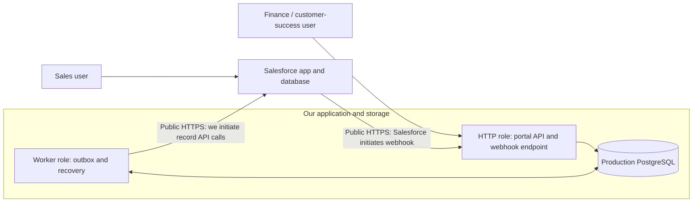

# Two-way customer and contact synchronization

24 November 2026. Consolidated submission design from Phases 1–6. This is a conditional design, not an implemented or Salesforce-verified service. The brief is [Round1-Tequity.html](../Round1-Tequity.html). Linked specifications supply schema, pseudocode and failure-case detail.

## 1. Assumptions and questions before locking the design

Production stores five million customers and contacts combined in PostgreSQL. Customers have name, status and owner; contacts have full name, phone, email, city, owner and customer reference. The introductory billing-city example does not expand that explicit list. Every distinct captured edit remains attributable in our history, including losing and intermediate edits. Both replicas converge on current values; mirroring every intermediate edit into Salesforce audit is a separate requirement (Q21).

The complete question/answer/consequence register is [assumptions.md](assumptions.md), Q01–Q21. All answers remain provisional. The decisions that could change this design are:

| Question | Assumption | What changes if false |
|---|---|---|
| Peak, quiet and burst rates? Q01 | Each direction: 20 original edits/s sustained peak, 1/s quiet; 40/s for five seconds, no repeat until excess drains. One record: 1/s sustained, five burst edits. | Recalculate latency, contention, storage and recovery. |
| Patch or full record? Q02 | Changed fields only; omission means no edit; nullable explicit null clears. | Full snapshots need trustworthy change masks/field versions and attributable history; diffing snapshots cannot recover overwritten edits. |
| Can missing edits be replayed? Q03–Q04 | Complete durable history, immutable identities, values, actors, times, source revisions, stable partition cursors/manifests and terminal high-water proofs; at least 72-hour retention. | Snapshot polling repairs some current state but cannot meet history. Obtain integration/archive access or change the requirement. |
| What means current? Q05–Q07 | Latest per-source field revision, then compare source times; portal wins exact ties. Portal actor is authenticated, time/revision server assigned. Source clocks provisionally within ±1 s. | Negotiate business arbitration or stronger ordering; recorded timestamps cannot establish physical order within clock uncertainty. |
| Can ambiguous writes be resolved safely? Q08–Q10 | Non-destructive unique external-ID create-or-resolve; atomic revision-conditional patches; complete history through the read revision; stable mutation resolution/fencing and per-field original provenance. | Reads alone do not close races. Block unsafe retries; duplicate-free creation, preserved unseen edits and loop safety cannot be guaranteed. |
| Mapping, schema and delivery? Q11–Q13,Q18–Q19 | Stable record/owner IDs; parent before contact; signed bounded events; bounded delay/duplicates; explicit field types/nullability. | Block unresolved work visibly, adapt adapter/schema, and recalculate delay/cost. Do not fuzzy-match people. |
| Capacity and latency? Q14–Q15 | Shared 90 requests/s pacing, at least 89/s achieved service, three calls/mapped job and ≤10/s exceptional overhead. Catch-up has a separate target. | Lower quotas, more pages, retries or bursts change ETA and can prevent drain. Worst-case healthy 30 s remains unproven under the stated burst. |
| Existing data, retention and delivery? Q16–Q17,Q20 | Controlled snapshot+replay bootstrap; history from agreed capture boundary; durable PostgreSQL survives process restart; no required local history pruning. | Historical backfill, live cutover and database-loss recovery need additional scope. Authentic chat export and revised submission deadline remain pending. |

Salesforce stays as it is. The brief supplies webhooks and record create/update APIs, not the additional contracts above. Their availability must be confirmed before promising correctness; no real Salesforce capability has been verified. A fake adapter could demonstrate assumed semantics only.

The original worst-case healthy target is 30 seconds. Inbound planning is `5 delivery + 10 queue/lock + 2 commit + 3 visibility = 20 s`. A three-call outbound nominal envelope is `2 commit + 5 total waiting + 15 API + 3 visibility = 25 s`, but burst arithmetic does not prove that waiting bound. The stricter candidate envelope is `2 + 20 + 3×2 + 2 = 30 s`: calls ≤2 s, total waiting ≤20 s, visibility ≤2 s, resolved dependencies and no extra race/page. Scheduling and connection measurements must prove it, or the admitted workload/interface/requirement must change. Sustained capacity is not a worst-case latency proof.

## 2. Systems, callers, network boundary and interfaces

Choose one application with HTTP and worker roles. PostgreSQL is the durable boundary between roles, even if they run in separate processes. No correctness-critical queue lives only in memory.

Portal create/patch accepts an explicit patch and request key; authentication supplies actor. Response after commit includes accepted edit ID, authoritative revision/time, resolved values/winner IDs and pending/synchronized/blocked status. Read APIs expose current state and paginated history.

`POST /webhooks/salesforce` adds to the sample: tenant/account/schema, operation, source incarnation, immutable original edit ID, record revision, stable actor ID and per-field propagation provenance. These separate duplicate delivery, original edits and our remote applications. Provisionally authenticate HMAC-SHA256 over delivery timestamp and exact body, with ±300-second delivery window, rotated account secret and ≤64 KiB body. Edit time is independent: old replayed changes remain valid. Reject invalid encoding, duplicate JSON keys, unknown fields, wrong types and authority mismatch.

Worker adapter operations are `readRecord`, `readHistoryThrough(record,R)`, `conditionalPatch(record,R,patch,provenance)`, `createOrResolve(externalUuid,mutationId,fields)` and partition replay through a stable high-water boundary. These are required semantics, not claimed native endpoint names. All adapter requests consume our shared budget; inbound webhooks do not. See [architecture.md](architecture.md) and [inbound-flow.md](inbound-flow.md).

## 3. Subproblems and build order

| Order and subproblem | Component justified by it |
|---|---|
| 1. Recover every edit and safely arbitrate concurrent fields | Validate adapter feasibility; shared deterministic field resolver and immutable edit contract. |
| 2. Survive restarts and concurrent local decisions | PostgreSQL repository, entity locks, unique identities and atomic history/projection/outbox transactions. |
| 3. Apply external deliveries once | HTTP validation and transactional inbound routine, reused by replay. |
| 4. Propagate changes despite ambiguous responses and throttles | Durable worker state machine, per-record dispatch and sole paced egress sender. |
| 5. Resolve creates, owners and parents | Source mapping and indexed dependency waiters; no separate service needed. |
| 6. Recover missed history before stale writes | Replay manifests, contiguous checkpoints, recovery barrier and fair scheduling. |
| 7. Explain and validate the behavior | Three operational metrics below, worked scenarios, submission artifacts; optional fake-CRM demo only in Phase 8. |

Indexed database polling finds due work; optional wake-ups only reduce delay. No Redis or external queue is needed for the chosen subproblems.

## 4. Data stored

Use PostgreSQL transactions with synchronous durable commit. Tenant-scoped UUID entities and typed customer/contact projections represent current state; unique source-account/object/incarnation/record-ID mappings prevent duplicate identity. Owner mappings and parent references are explicit.

Store two original-source candidates per entity/field, resolved winner identity/value and generation; immutable edit facts/field values with actor, source time/revision and identity; append-only decision evidence; separate baselines, event receipts/hashes and application evidence. Receipt IDs deduplicate transport; original commit/edit uniqueness also prevents alias deliveries from inventing edits.

Durable work includes individual outbound jobs and field outcomes, immutable prepared mutations/attempts, per-record dispatch/lease epochs, remote revision/history-coverage evidence, dependency waiters, account pacing/cooldown, replay epochs/high-water vectors/pages/manifests/completion markers/checkpoints, and bounded validation incidents. See [data-model.md](data-model.md) for columns, keys, indexes and crash boundaries.

All local entity decisions use short entity-row locks, deterministic multi-entity lock order and final unique constraints. No HTTPS occurs inside a database transaction. History, candidates, current values, receipt/request response and resulting intent commit together. Network preparation and result application are separate durable transactions with generation checks; an old response cannot replace a newer winner.

Hot queries use entity/source IDs, due-job indexes and per-record history indexes, not five-million-record scans. Two candidates/field imply 30–60 million rows at the field-count extremes; measure real distributions/query plans. Planning storage is about 16.77 GiB/day logical incremental data at sustained peak including jobs/evidence/overhead. The illustrative initial envelope is about 150 GiB primary disk including separate WAL allowance, plus retained history, backups and replicas. These are estimates, not measured sizes. Upstream replay retention is separate from local audit retention; no required history is deleted to fit a disk example.

## 5. Inbound path: webhook to database

1. Authenticate and bound the body, validate schema, identities, patch and provenance. Delivery timestamp authenticates a delivery, not original edit order.
2. Begin transaction; resolve identity and lock entity/dependencies. An identical committed event ID/hash returns prior success with no new business effect. Same ID/different content is an integrity failure.
3. Verify logical edit/commit uniqueness. Append all distinct original edits; verified propagated fields append application evidence instead. A mixed event is atomic.
4. Advance only affected source-field candidates, recompute winners, append decisions and update projection/status. Keep late and losing facts. Persist unresolved references and repair intent if current remote agreement cannot be established.
5. Insert receipt and, for replay, manifest-entry completion. Commit before 200. A committed duplicate encountered in replay still completes its manifest entry atomically.

Interpret “check and apply before anything is stored” as validation followed by one atomic application transaction, never a successful raw-inbox-only acknowledgment. Older edits are applied by auditing/evaluating them even when they lose. Invalid events have no accepted business receipt; bounded diagnostics are separate. Authentication/schema/integrity errors return stable 4xx reasons (integrity conflict 409); transient database failure returns retryable failure, never success before commit.

Unknown updates create mapped placeholders with attributable candidates, not invented required values. Missing owner/parent retains exact reference history and blocked status; hydrate and wake indexed waiters later. These exceptions cannot promise 30 seconds. Detailed errors and 16 scenario outcomes are in [inbound-flow.md](inbound-flow.md).

## 6. Outbound path: portal save to Salesforce

Portal authentication supplies actor. Under the entity lock, allocate monotonic portal revision and database-server timestamp at the serialized decision boundary; this is not an unavailable eventual WAL commit timestamp. Commit request-key response, immutable edit, candidates/decisions/projection and individual outbound intent together. A request retry with identical key/body returns the prior result; changed body is a conflict.

Worker claims due work with lease epoch and per-record dispatch slot. Jobs have READY/BLOCKED/LEASED/RETRY/UNCERTAIN/SUCCEEDED/SUPERSEDED/FAILED states and explicit field outcomes. Confirm parent mapping before contact creation. An unresolved mutation blocks newer mutations for that record.

For a mapped update, read revision R and acquire/apply complete original history through R before deciding a patch. Under the local lock, re-evaluate winner identities, mark obsolete unsent fields superseded, and durably prepare an immutable mutation against R with original provenance. Send only differing fields with an atomic R precondition. A concurrent remote edit causes no-effect precondition failure, then history refresh/recompute. A response records evidence and rechecks generation; newer winners retain follow-up work. All edits/jobs remain accountable even if an obsolete value is never sent.

Creates use stable canonical UUID and non-destructive create-or-resolve. An accepted request with lost response becomes UNCERTAIN, not failed. Resolve exact mutation identity/application history; never blindly replay a stale patch over newer edits or reinitialize an existing created record. A read showing no application is insufficient while the request could still execute. Unsupported safe resolution blocks the record visibly.

One fenced egress sender spaces actual request starts by `ceil(1,000,000/C)` microseconds: 11,112 µs at C=90 and 10,000 µs at C=100, measured with a monotonic clock over half-open rolling one-second intervals. No burst credit or hidden library retries. Reads, pages, creates, patches, repairs, retries, probes and controls all count. Persist effective rate/cooldown; honor Retry-After and bounded exponential jitter. Permanent failures retain history/work and require remediation. Account outage probing replaces per-job retry storms. Confirm old sender termination/fencing before takeover, wait a full second and honor cooldown; lease expiry alone is insufficient. If timing precision requires wider spacing, recompute throughput and recovery ETA; the achieved 89/s service floor requires measurement. See [outbound-flow.md](outbound-flow.md).

## 7. Concurrent changes to the same record

For each field first select the greatest original `sourceRevision` within each origin. Compare those two candidates by `(occurredAt in UTC milliseconds, originRank)`, PORTAL=1 and SALESFORCE=0. The greater tuple wins. Do not compare source revisions across origins or implement a non-transitive pairwise comparator. Retaining only the current winner would fail under source clock rollback.

Different fields resolve independently: portal city=Noida and Salesforce phone=B both survive. Same-field phone=B at portal :05 versus phone=C at Salesforce :04 resolves to B regardless of delivery order; retain both facts and conditionally repair Salesforce if necessary. Exact-time tie chooses portal. This is explicit business arbitration, not proof of physical last-human-edit order with uncertain clocks.

Two portal stale-screen patches are accepted in serialized server order; same-field higher portal revision becomes that source's candidate, different-field patches preserve each other. Responses return resolved current values, possibly different from the submitted value, plus accepted edit/status. A later refresh shows later winners. Whole stale forms cannot silently reassert unchanged fields. See [conflict-rules.md](conflict-rules.md), cases A–N including clock rollback, clears and remote races.

## 8. Duplicate and older webhook rules

A duplicate with the same event identity and canonical content has no additional edit, decision, generation or repair effect; retry after commit/before response is safe. Alias wrappers must match existing logical-edit content. A distinct source revision with the same value is a new edit and stays in history.

For newer S2 phone=C followed by older S1 phone=B, city=Noida, retain both facts; phone stays C, city can advance to Noida. Never reject the entire event using a record-level latest revision. Null is an explicit nullable clear; omission is no edit. Snapshot-only full-record input without trustworthy change metadata cannot be treated as complete edit history.

## 9. Loop prevention

A mutation carries each field's original edit identity. Verified returning propagated fields update application evidence, not human candidates or a new timestamped edit. An old echo cannot revive an obsolete value. No return write is created solely for an echo.

Do not ignore every event from the integration account. Genuine changes, including attributable side effects and original fields in mixed events, are audited and resolved normally. A losing remote edit can require a conditional repair carrying the existing portal winner; suppressing all inbound-triggered writes would prevent convergence. Deduplicate repair intent by entity/generation and wake it again when new evidence invalidates agreement. Provenance mismatch is an incident, not silent suppression. Under finite edits, complete replay, safe conditional writes and sufficient capacity, candidates are order-independent and repairs converge without manufacturing new edits.

## 10. Six-hour outage: disk, recovery and arithmetic

Portal saves continue committing history/current fields/individual jobs. Persist retries, uncertain mutation identities, attempts, dependencies, cooldown and replay checkpoints/manifests. Process restart recovers these rows; before-commit work rolls back. During account failure, pause ordinary dispatch and use at most one paced read-only probe/minute after detection, respecting longer cooldown. Webhooks that arrive still apply normally; missing ones cannot be assumed absent edits.

On reconnection freeze remote mutations; capture/persist high-water vector H and replay from a retained committed cursor with bounded overlap. Feed every page through the same inbound transaction. Checkpoints advance only through contiguous fully committed manifests; a later complete page cannot skip a poison entry or gap. Persist authoritative completion through every partition's H before releasing the account barrier. Resolve uncertain mutations before later writes to their entities. Then each job still obtains complete history through its current read revision before conditional write; H does not cover later edits. Keep incremental replay polling (healthy interval ≤5 s) during catch-up.

| Calculation at sustained 20 original edits/s each direction | Result |
|---|---:|
| Portal jobs and missed Salesforce original edits, each `20×21,600` | 432,000 each |
| Replay entries with ≤1,000 boundary overlap; pages `ceil(433,000/500)` | 433,000 entries; 866 pages |
| Add four discovery/terminal calls; fetch `870/5/60` | 870 calls; 2.90 min fetch floor |
| Replay ingestion at reserved 100 entries/s plus 50 s allowance: `(433,000/100+50)/60` | 73 min barrier |
| Jobs at release `432,000+20×4,380` | 519,600 |
| Ongoing jobs `20×3` calls/s; exceptional overhead | 60/s + 10/s |
| Net old-job service `(89−60−10)/3` | 19/3 = 6.333 jobs/s |
| Drain `519,600×3/19/60` | 1,367.37 min |
| Total `73+1,367.37` | **1,440.37 min, about 24 h** |

This supersedes the earlier one-call 120-minute example. The three calls are revision read, one complete record-history page and conditional patch. Overhead allocation is 2/s repairs, 2/s retry/ambiguity, 1/s dependencies, 1/s stream replay, 1/s discovery/control and 3/s reserve. Together 60+10+19=89 achieved starts/s, within 90/s configured pacing and 100/s cap. Stage A incremental post-H replay/probes are additional actual calls within the same cap, separate from the 870 fixed-boundary calls.

Local ingestion assumption is 200 applications/s, split live 100/replay 100. Stage B produces about 47 source events/s including echoes; one duplicate each gives 94 live applications/s. Full 500-entry pages need about 0.094 replay calls/s plus bounded polls/overlap within the 1/s stream share. More pages/duplicates/races change the model. At five-second calls, ≥445 concurrent request slots plus headroom are needed for 89/s; daily quotas must support millions of calls. History retention 72 h covers about six outage plus 24 recovery hours with roughly 42 h margin under these bounds.

Fair scheduling reserves positive service for fresh work, old jobs, repair/dependencies and replay, lending idle shares. Catch-up has a separate target, including fresh writes while the barrier or backlog exists. Recovery is complete only after historical coverage, uncertain mutations, old jobs, dependencies/repairs and incremental replay are resolved and queues fit healthy bounds. Blocked work prevents a whole-account synchronized claim.

General drain is `a×B/(R−a×p−E)/60` minutes plus barrier, only if denominator >0. At R=70, p=20, a=3, E=10 there is no drain. Two history pages/job give a=4 and negative drain at R=89. Quiet 1/s each gives approximately 19 minutes total. Never violate the cap or delete history to preserve an old ETA. Full restart table, storage assumptions and sensitivity are in [recovery-capacity.md](recovery-capacity.md).

## 11. Exactly three primary operational numbers

These are proposed operational policies, not measured service results. Evaluate per source account; retain direction/class labels without hiding a slow record behind an average. Diagnostics support these three metrics rather than adding primary dashboard metrics.

| Primary number | Concrete escalation threshold | Reason and action |
|---|---|---|
| 1. Oldest unconfirmed original-edit propagation age, seconds | Healthy mode: page at ≥30 s on any sample; warn at ≥20 s for 60 s. Include blocked accepted edits; do not reset age on retry. | Directly exposes target risk. Age from trusted original timestamp to confirmed destination visibility; absent visibility evidence remains unconfirmed. Source clock uncertainty is disclosed. For source events not yet observed, use replay coverage guard below rather than pretending their age is known. Recovery is explicitly labeled and evaluated by metric 3. |
| 2. Maximum outbound starts in any rolling one-second window | Page immediately if >100; investigate if >90 at current configuration. | Tests the actual shared cap, including retries/read/replay/control. Derive from sole-egress start ledger, not completed calls or separate worker counters. Stop dispatch on a hard-cap violation, retain work, investigate hidden retries/fencing. This measures client initiation; arrival-based upstream semantics remain a contract question. |
| 3. Recovery retention safety margin, hours | Page if margin <6 h, or immediately on confirmed gap/expired cursor/no positive drain. | Margin = upstream retention remaining at oldest uncommitted cursor minus estimated remaining end-to-end recovery. Estimate with measured ingestion, request amplification, eligible-job service and ongoing arrivals; unknown completeness/ETA is unsafe and pages immediately. If non-positive drain persists 5 min with pending work, set margin to unsafe; a confirmed irrecoverable gap needs no wait. Escalate adapter capacity/access or workload/contract changes while preserving disk state. |

Lag monitoring cannot establish a production worst-case bound or detect every missing webhook instantly. Continuous replay coverage and the explicit feasibility gates remain necessary.

## 12. Weekend exclusions and submission state

Exclude deletes, Salesforce login screens, visual UI, second region, real Salesforce load tests and a production-ready service. Controlled bootstrap execution, pre-capture historical backfill, database-loss disaster recovery and full production hardening need separate work. No code is required for the assignment. Optional Phase 8 would use TypeScript on Node.js 20+, fake Salesforce and durable local persistence; `npm install` plus one command, no external PostgreSQL/Redis/Docker. Demo persistence can show process-restart behavior, not production PostgreSQL guarantees or throughput.

Design review covers duplicates, late events, echo/repair loops and six-hour recovery end to end; this is manual reasoning, not executed application tests. Unsupported upstream capabilities and healthy worst-case latency remain explicit production gates. The [walkthrough](walkthrough.md) allocates ten minutes; [submission checklist](submission-checklist.md) records repository and authentic-chat gaps. Required submission is not yet complete: full unedited chat coverage remains unverified/pending, and current working artifacts are not all committed. No chat was rewritten, commit fabricated, or external submission sent.
