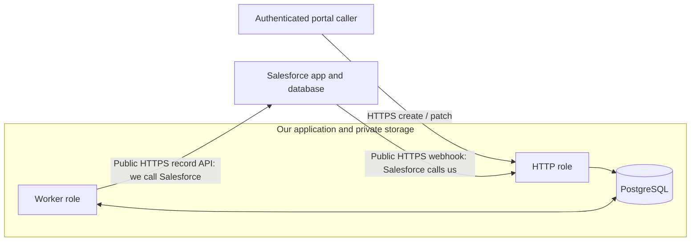

# Two-way customer and contact synchronization

24 November 2026. Reviewer-facing design; implementation details are linked by section. This is a conditional design, not an implemented or Salesforce-verified service. Source: [assignment](../Round1-Tequity.html).

## 1. Assumptions and questions before locking the design

Five million customers and contacts combined, stored in PostgreSQL. Customer fields: name, status, owner. Contact fields: full name, phone, email, city, owner, customer reference. Both sides create and update; every distinct captured edit, including losing and intermediate values, retains actor and time.

| Question | Provisional answer; consequence if different |
|---|---|
| Peak and quiet traffic? | Each direction: 20 original edits/s peak, 1/s quiet; 40/s for five seconds, no repeat until excess drains. Per record: 1/s sustained, five burst edits. Higher traffic requires new capacity/latency arithmetic. |
| Changed fields or full record? | Changed-field patches; omission means no edit, nullable null means clear. Full records need trustworthy change masks/field history; snapshot differences cannot recover intermediate edits. |
| Can missing changes be recovered? | Complete attributable replay with immutable identities, source revisions, stable cursors and completion proofs; retention at least 72 hours. Without it, snapshots cannot satisfy history: obtain archive access or change the requirement. |
| What establishes order? | Per-source field revisions, then source timestamps; portal wins exact ties. Portal actor comes from authentication, time/revision from the server. Clocks within ±1 s are assumed; different policy/clock bounds require agreement. |
| Are safe writes available? | Unique non-destructive create-or-resolve, revision-conditional updates, history through the read revision, mutation resolution/fencing and original per-field provenance. Without these, block unsafe writes; correctness is unproven. |
| What capacity and mappings exist? | Stable record/owner IDs, resolvable parents; 90 calls/s pacing, 89/s achieved service, three calls/mapped update and ≤10/s exceptional overhead. Lower quotas, extra pages or unresolved dependencies change recovery and latency. |

These upstream capabilities are assumptions, not verified Salesforce features. The full [question register](assumptions.md), Q01–Q21, records alternatives, schema/delivery bounds, bootstrap and retention decisions.

**The healthy worst-case 30-second requirement remains a feasibility gate.** Inbound allocation is `5 delivery + 10 queue/lock + 2 commit + 3 visibility = 20 s`. A candidate outbound bound is `2 commit + 20 total waiting + 3×2 API + 2 visibility = 30 s`; burst scheduling, connections and timing must prove it. Extra pages/races or blocked dependencies invalidate that envelope. Sustained throughput alone is insufficient.

## 2. Systems, callers, network boundary and interfaces

One application has HTTP and worker roles, communicating through committed PostgreSQL state. No volatile queue determines correctness.

Portal create/patch accepts a request key and patch; returns committed edit ID, revision/time, resolved values and sync status. Reads expose current state and paginated history. `POST /webhooks/salesforce` keeps the sample fields and adds tenant/account/schema, operation, source incarnation/revision, original edit identity, stable actor ID and field provenance: these distinguish originals, duplicates and echoes. Authenticate signed deliveries and validate authority/schema.

Worker interfaces are revision read, history-through-revision, conditional patch, create-or-resolve and bounded replay. These name required adapter semantics. [Interface details](architecture.md).

## 3. Subproblems and build order

First settle risky ordering, replay and safe-write contracts. Then build: field resolution; transactional persistence and identity constraints; authenticated inbound application; durable outbound delivery/rate enforcement; parent/owner mapping; replay and backlog coordination; operational checks. PostgreSQL supplies locks, indexed work polling and durable jobs; HTTP handles acceptance, workers handle external calls. Each component addresses one of these subproblems; no broker is required.

## 4. Data stored

Store customer/contact projections; unique source-ID and owner mappings; two source candidates and a resolved winner per field; immutable edits with values/actor/time/revision; decision evidence; deduplication receipts; outbound jobs, prepared mutations and attempts; dependencies; pacing/cooldown state; replay manifests, completion markers and checkpoints.

Short entity-row locks serialize decisions. History, current values, receipts and work commit atomically; network calls occur outside transactions. Leases have epochs; stale responses cannot replace newer winners. Indexed identity, ready-job and per-record history lookups avoid scanning five million records. Illustrative sizing is 16.77 GiB/day incremental at sustained peak; actual PostgreSQL sizes require measurement. [Schema, indexes and crash boundaries](data-model.md).

## 5. Inbound path: webhook to database

Authenticate and validate the bounded envelope and explicit field patch. In one transaction: resolve/lock identity, deduplicate, append distinct original edits, update source candidates/winners, persist dependency/repair intent, record receipt and commit. Return success only afterward; a crash before response is safe to retry. This interprets “check and apply before storing” as atomic application, never raw-inbox-only success.

Invalid input receives stable 4xx errors; transient database failure is retryable. Unknown records use mapped placeholders; missing parents/owners preserve exact references and history with visible blocked status until hydration. Such exceptions cannot promise 30 seconds. [Pseudocode and error cases](inbound-flow.md).

## 6. Outbound path: portal edit to Salesforce

Under the record lock, authenticate actor and assign server revision/time; commit history, resolved fields, request-key result and individual outbound job together. Workers claim durable jobs and serialize attempts per record. Create customers before dependent contacts using stable UUIDs and non-destructive create-or-resolve.

For mapped updates: read revision R, ingest complete original history through R, recompute winners and conditionally patch only differing fields against R. A remote race fails without effect; refresh/recompute. Record outcomes with local generation checks. Obsolete fields may be superseded, but their edits remain audited. A lost response becomes UNCERTAIN: resolve the exact mutation before later writes; never blindly retry a stale patch or reinitialize a created record.

One fenced egress sender spaces actual starts by `ceil(1,000,000/C)` microseconds; C=90 gives 11,112 µs. Every rolling half-open second stays within C≤100. Count retries, failed attempts, reads, pages, writes, probes and repairs; inbound webhooks are outside the cap. No burst credit or hidden retries. Honor Retry-After and backoff with jitter; keep failed/blocked work. On takeover, stop/fence the old sender, wait a full second and retain cooldown. [Job states and failure handling](outbound-flow.md).

## 7. Concurrent changes to the same record

Resolve each field independently. Within each origin choose the greatest original `sourceRevision` affecting that field; between those two candidates choose the greater `(occurredAt UTC milliseconds, originRank)`, with PORTAL=1, SALESFORCE=0. Never compare revisions across sources. Keep both candidates so clock rollback cannot make arrival order change the answer. Timestamp arbitration is a business policy, not proof of physical edit order.

Portal city=Noida and Salesforce phone=B both survive. Same-field portal B at :05 beats Salesforce C at :04; retain both and repair Salesforce conditionally. Same-side portal saves serialize by server revision; responses show accepted edit, resolved values and sync status, even if the submission loses cross-source arbitration. Refresh shows later winners. Stale whole forms cannot reassert unchanged fields. [Worked examples](conflict-rules.md).

## 8. Duplicate and older webhook rules

Same event identity and canonical content: return the committed result without another edit or job. Same identity with different content: integrity error. A distinct edit with the same value still enters history.

If S2 sets phone=C and older S1 later supplies phone=B, city=Noida, audit both; keep C and accept Noida if its source-field revision advances. Never discard a whole event using record-level latest revision. Replay uses the same deduplication/application routine.

## 9. Loop prevention

Outbound mutations carry original field edit identities. A verified echo records application evidence without a new human candidate, timestamp or return job. Old echoes cannot roll back winners. Do not suppress every integration-account event: genuine and mixed original edits still enter history. A losing remote edit may need a repair carrying the existing winner; deduplicate repair intent by entity/generation. Provenance mismatch is an incident. Complete replay, safe conditional writes and sufficient capacity permit convergence after edits settle.

## 10. Six-hour outage: disk, drain and minutes

History, individual jobs, uncertain mutations, attempts, dependencies, cooldown and checkpoints survive process restart in durable PostgreSQL. Pause ordinary outbound attempts during outage; use at most one paced read-only probe/minute after detection, honoring longer cooldowns.

On recovery, freeze mutations and persist source high-water boundaries H. Replay missing history with bounded overlap through the inbound transaction. Advance checkpoints only over contiguous committed entries; gaps block completion. Release writes only after proof through every H, then still acquire per-record history through each fresh read revision before patching. Snapshots alone cannot recover intermediate edits or actors.

| Peak calculation | Result |
|---|---:|
| Portal jobs and missed remote originals, each `20×21,600` | 432,000 each |
| Replay including 1,000 overlap: `ceil(433,000/500)+4` control calls | 870 calls |
| Fetch floor `870/5/60`; ingestion barrier `(433,000/100+50)/60` | 2.90 min; 73 min |
| Jobs after barrier `432,000+20×4,380` | 519,600 |
| Net old-job service `(89−20×3−10)/3` | 19/3 jobs/s |
| Drain `519,600×3/19/60` | 1,367.37 min |
| Total `73+1,367.37` | **1,440.37 min, about 24 h** |

Three calls/job mean revision read, one history page and conditional patch. The 10/s overhead covers repairs, retries/ambiguity, dependencies, replay, controls and reserve. Local ingestion assumes 200 applications/s split live/replay 100 each; achieved egress assumes 89 starts/s within 90/s pacing and adequate daily quotas/connections. These are estimates requiring confirmation. Quiet 1/s each yields about 19 minutes. The earlier one-call 120-minute example is superseded.

Fair scheduling reserves fresh, old, replay and repair service, lending idle shares. Catch-up has a separate target, including fresh writes during recovery. Resume healthy status only once history, uncertain/blocked work and backlogs are resolved within latency bounds. At 70 calls/s, `70−60−10=0`: no old-job drain. More history pages also change the ETA. [Full accounting, restart cases and sensitivity](recovery-capacity.md).

## 11. Three operational numbers and escalation

| Primary metric, per account | Escalation and reason |
|---|---|
| Oldest unconfirmed propagation age | Healthy: page at ≥30 s; warn at ≥20 s for 60 s. Include blocked edits; retries never reset age. Detects visibility-target failure. |
| Maximum outbound starts in any rolling second | Page immediately >100; investigate >90 at this configuration. Use the shared actual-start ledger; stop unsafe dispatch and retain work. |
| Recovery retention safety margin | Page <6 h, or immediately for a confirmed gap/expired cursor/unknown completeness or ETA. Margin = retention remaining at oldest uncommitted cursor minus estimated recovery. No positive drain for five minutes makes it unsafe. |

Unobserved missing events require replay coverage monitoring; observed propagation age alone cannot detect them or establish a latency guarantee.

## 12. Weekend exclusions and submission state

Exclude deletes, Salesforce login screens, visual UI, second region, real Salesforce load tests and production hardening. Bootstrap execution, pre-capture history backfill and database-loss recovery need separate scope; no required local audit pruning is assumed.

Optional code is unstarted. It would use TypeScript/Node.js 20+, fake Salesforce and local durable persistence, runnable with `npm install` plus one command; local storage demonstrates process restart, while production uses PostgreSQL. No external services are required for that demo.

The [ten-minute walkthrough](walkthrough.md) uses these section numbers. Full chats, repository packaging/access and revised delivery are closed on user confirmation, without independent external verification; see [submission checklist](submission-checklist.md). Detailed specifications are reference material for implementation/questions. Review is design reasoning only; upstream capabilities and worst-case healthy latency remain unresolved production gates.
