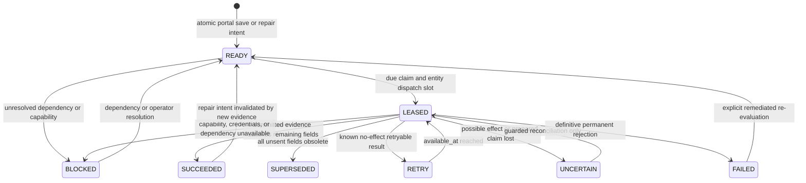

# Phase 5: outbound synchronization

24 November 2026. Design specification, dependent on `assumptions.md`, `conflict-rules.md`, `data-model.md`, `architecture.md`, and `inbound-flow.md`. The original brief requires durable pending calls, a cap including retries, no endless echo loop, and field-level conflict/history preservation. This document specifies our worker; it does not implement it or verify real Salesforce features. Full six-hour replay coordination, scheduling allocations, and capacity arithmetic remain Phase 6.

## 1. Contracts and durable portal acceptance

Use production PostgreSQL and the existing tables/locks from Phase 3. HTTP saves never wait on Salesforce. Authenticate tenant and actor, validate the Phase 4 field allowlists/types/nullability and explicit changed-field semantics, then perform one transaction:

1. Resolve the canonical entity, lock its entity row, and check the principal/entity-scoped portal request key and canonical content hash. A committed identical retry returns its stored result; changed content under the same key fails. A retried create reuses its previously allocated UUID/request identity.
2. Allocate the next portal record revision and database decision-boundary timestamp, append immutable edit fact/fields, update affected PORTAL candidates, and recompute winners under Phase 2. Update resolution generation, decision evidence, and current projection/lifecycle atomically. Browser actor/time and full-form snapshots are not authoritative.
3. Insert one outbound intent for this edit, its individual field dispositions, and any dependency waiters. Store desired original edit IDs, not just values. Preserve losing/equal-value edits and their work outcomes even if no remote patch is ultimately needed. Insert the retry response in `portal_requests`.
4. Commit with the Phase 3 durable-storage assumption, then return accepted edit ID, revision/time, resolved values/winners and pending/blocked status. A lost HTTP response repeats the request key. A failed transaction accepts neither the edit nor its job.

Portal creates retain all creation facts, but the eventual remote creation uses the latest resolved required values and attributable field identities. Missing parent/owner mappings block dispatch. Acceptance is durable history plus intent, not a promise that the submitted value wins or that Salesforce already displays it. On restart, indexed polling rediscovers committed due work; optional wake-ups are only a latency aid.

Upstream assumptions remain Q03/Q04/Q08/Q09/Q10: complete original history through a named remote revision; atomic conditional field patches; unique, non-destructive create-or-resolve or durable idempotency; original per-field provenance; and safe resolution of outstanding ambiguous requests. These are adapter semantics, not names of verified Salesforce endpoints. Without them, block or explicitly weaken the guarantee. Do not substitute a snapshot for history or blind upsert for safe creation.

## 2. Ordering, dependencies, and patch preparation

Select due work fairly across entities, using `FOR UPDATE SKIP LOCKED` with short transactions. For one entity, select oldest eligible intent by initiating portal revision (repair intents use durable creation order, then job ID). Use one `record_dispatch` slot per entity. There is at most one unresolved remote mutation for that entity, regardless of how many workers, portal intents, or repair intents exist. Reads/reconciliation for that mutation may continue; a newer remote mutation cannot bypass it. Different entities can progress concurrently.

Re-evaluate each job under the entity lock before dispatch. An unsent field whose desired edit ID no longer wins is SUPERSEDED with reason and replacement winner ID; preserve its fact/job. An equal-value but distinct winning edit remains in history; established current value agreement can satisfy its application without fabricating a remote human edit. Do not combine multiple pending portal jobs into one mutation. A repair intent may refer to the current winners across fields, but retains their individual original identities and does not delete or replace the portal intents. Reuse Phase 4's entity/generation repair intent when later evidence invalidates earlier satisfaction.

For contact creation or customer reassignment, resolve the current winning customer reference to a confirmed remote customer ID before preparing the contact mutation. An uncertain parent create is not a confirmed mapping. Resolve owners through stable principal mappings. BLOCKED jobs name the dependency and wake via indexed waiters; recheck current winners when awakened. Remote-existing placeholders need hydration/history, not automatic duplicate creates. Invalid/missing/cyclic mappings require visible remediation; no arbitrary parent/owner substitution or hot retry loop. Parent creation and dependent contact creation are separate budgeted calls.

For a mapped entity:

1. Obtain a trustworthy remote observation `(R, values)` and complete attributable history coverage through R. Cached evidence is usable only if its proof covers the exact expected revision; a largest received webhook revision does not prove coverage. Otherwise fetch a record/history boundary and every required history page through that boundary, all through the shared cap. Use the inbound routine to ingest original edits, echoes, and dedup overlap. If a snapshot/history boundary cannot be aligned, repeat or block; do not infer coverage from current values.
2. Under entity/dispatch locks, recheck the claim epoch, dependencies, latest winners, and covered observation. Compute only the still-current job fields that differ from observed remote values. Omitted fields are untouched; nullable clears are explicit null; convert reference values using confirmed mappings. Other divergent fields get their own deduplicated repair intent. A repair job may patch its current target fields after the same checks.
3. If there is no necessary patch, retain per-field satisfied/superseded evidence and finish without an API write. Satisfaction means agreement at the evidence revision, not permanent agreement against future edits. Do not assert remote edit provenance merely from equal values.
4. Otherwise persist an immutable mutation: stable mutation ID, job/entity/account, exact patch, each field's original edit ID/version/actor/time, expected remote revision R, prepared local generation, and dispatch epoch. Commit before network I/O. A changed patch or precondition gets a new mutation ID after the earlier request is known resolved; identical retries keep identity.

For a genuinely unmapped portal entity, prepare a create with stable external UUID, mutation ID, current required fields and per-field original provenance. The assumed create operation must atomically create once or return the existing identity **without resetting existing fields**. A generic update-on-match upsert is insufficient. On an existing result, map safely, read/merge its complete history, and use subsequent conditional patches. An earlier uncertain create must be resolved first. If a create payload becomes obsolete before any possible send, discard its unsent preparation with evidence and rebuild; if it may have been sent, reconcile first.

No entity/database transaction spans HTTPS. A generation change after preparation does not authorize replacing the immutable body in flight. A newer edit keeps durable follow-up intent; an old successful response cannot overwrite newer portal candidates.

## 3. Job state machine and acknowledgment

Field dispositions distinguish pending, applied with evidence, value-already-agreed, and superseded with reason. Job SUCCEEDED means its remaining relevant fields were satisfied at an identified remote observation/application; it does not mean every saved historical value was sent. If every field became obsolete without application, finish SUPERSEDED. A partially applied/partially superseded job may finish SUCCEEDED with explicit field outcomes. FAILED and BLOCKED remain retained and visible, never silently dropped.

The SUCCEEDED→READY transition is for a reused repair intent as specified in Phase 4, not permission to resend an already acknowledged immutable mutation. Reopening does not erase previous attempts/evidence. SUPERSEDED portal intents remain terminal; current winners already have their own intent/repair. Reconciliation that remains inconclusive returns to UNCERTAIN with a future due time or BLOCKED with a visible reason.

Provisional worker timing: poll at most once per second when idle; leases last 30 seconds and renew every 10 seconds; a network attempt has a 5-second total deadline. These are tuning assumptions, not upstream guarantees. Claim/reclaim increments lease epoch. A lease expiring before preparation allows ordinary re-evaluation; expiring after durable preparation treats the mutation as possibly sent, even if no send marker exists. A stale worker cannot finalize a reclaimed lease; its result is retained as evidence for the current reconciler. A fence in PostgreSQL alone does not cancel a request already outside the process.

Before dispatch, durably record an attempt referencing the immutable mutation, recheck epoch/generation as appropriate, and let the sole paced egress authority initiate HTTPS. Every attempt has a distinct attempt ID; mutation identity survives retries. A recorded attempt without a response is not proof the request left the machine, nor proof it did not. Read/page requests likewise retain task/cursor/outcome state and are safe to repeat; no incomplete page advances coverage/checkpoints.

On confirmed success, a short transaction under entity/dispatch locks validates mutation/epoch, records application evidence and returned remote revision, and establishes source-ID mapping for a confirmed create using the existing unique constraints. Complete field dispositions only as supported by that application/observation. Recompute whether newer winners need follow-up before releasing dispatch. A response to an older generation never rolls projections back. If mapping uniqueness conflicts, retain acceptance evidence and block for reconciliation; do not create another remote record. Persisting evidence and job completion is atomic. If this transaction fails, reconcile the still-durable mutation after restart.

A response may establish its own attributable application at revision R. It cannot establish complete unseen history before R unless the adapter explicitly supplies that coverage proof. Keep `observed_revision` and `history_covered_through_revision` separate. A delayed response/echo adds evidence but cannot lower the newest observation or satisfy a newer generation. Verified echo/replay evidence may arrive before the HTTP response; unique mutation/application evidence makes these confirmations compatible.

## 4. One strict outbound rate budget

Configure `C` as a positive integer requests/second, `1 <= C <= 100`; operate at C=90. Define the cap over **any half-open rolling one-second interval of request initiation**, including retries, failed connections, reads, history pages, identity/status lookups, creates, patches, repairs, and recovery roles. Inbound deliveries are outside the cap. Do not use fixed calendar-second counters, independent worker buckets, or a token bucket with saved burst tokens. Failed calls consume their slot; unused slots disappear.

Use the existing `outbound_budget` row per Salesforce account as durable coordination, and one active egress dispatcher for all those request types. Work roles submit durable request descriptors; they do not open direct Salesforce connections. The dispatcher can have multiple outstanding calls, but serializes **actual starts**, with spacing `delta = ceil(1,000,000 / C)` microseconds measured by a monotonic clock. For 90/s delta is 11,112 microseconds; for 100/s it is 10,000. Late scheduling starts one eligible request and sets the next start from the actual start; it never sends a catch-up batch. This spacing permits at most C starts in every half-open one-second interval. If the runtime cannot bound initiation timing at this precision, increase spacing conservatively; throughput may fall, never compensate with bursts.

The dispatcher owns and serializes the egress operation itself. A worker cannot reserve a future slot, pause, and later use that permission outside the dispatcher. After a pause, the dispatcher evaluates deadlines again immediately before initiation. No automatic HTTP client retries or redirects are allowed; each follow-up is a new explicitly paced attempt. If transport code retries invisibly the cap is not enforced. The timing definition is client request initiation, not arrival at Salesforce: arbitrary network delay can bunch arrivals, so an arrival-based cap needs an upstream-defined contract or enforcement and remains Q14.

Before each start, check durable throttle state, persist attempt/budget accounting, then initiate under the serialized dispatcher. Persist the next-start state conservatively. If accounting cannot commit, do not send. A crash after accounting but before send wastes a slot; after send but before completion leaves an ambiguous attempt. Do not refund either slot. Persistence/transaction overhead can reduce the achieved rate. Concurrent in-flight requests require enough connection capacity for the bounded latency; this is a Phase 6 sizing input, not measured throughput.

**Failover is fenced egress ownership, not just a database lease.** Require the previous dispatcher to be stopped and unable to initiate further calls before replacement starts (for example, a single supervised egress process with confirmed termination before restart). The replacement then waits a full monotonic second, honors persisted `throttle_until`, and begins with empty pacing credit. A confirmed process restart satisfies this ownership condition; an unreachable process with an expired database lease does not. If termination/fencing cannot be established, pause dispatch and expose blocked failover rather than risk two senders. Other HTTP/worker roles may stay available and save durable work. Shared database locking alone or future slot reservations cannot guarantee the cap if an old process can resume after takeover. This chooses availability loss during uncertain ownership over an unsupported cap guarantee.

Use wall-clock persistence for restart/retry deadlines, but monotonic elapsed time for active pacing. A detected backward/forward wall-clock discontinuity forces safe deadline reconstruction; conservatively pause dispatch when a persisted throttle cannot be interpreted safely. A restart never carries burst credit. The single egress boundary also applies to any other application clients counted in our Salesforce budget; if independent consumers exist, Q14 must allocate/enforce a shared aggregate cap. No claim is made about uncontrolled callers.

## 5. Errors, retries, throttling, and ambiguous effects

Set a provisional total attempt timeout of 5 seconds, covering connect/TLS/response; cancellation stops local waiting, not remote execution. A mutation that might have reached Salesforce becomes UNCERTAIN. Persist result class, attempt number, available-at, bounded diagnostic and correlation identifiers; do not log credentials or unbounded PII.

For known retryable no-effect failures use full jitter: `delay = uniform(0, min(60 s, 1 s * 2^(n-1)))`, n starting at 1 for consecutive failures. Store the chosen deadline so restarts do not redraw an earlier delay. Effective dispatch time is the maximum of job deadline, account throttle, pacing eligibility, dependencies, and reconciliation barriers. A zero jitter draw still passes the cap. Reset failure count after resolved successful progress. There is no automatic attempt-count discard or retry expiration for outage work. Persistent failures remain visible and may be blocked for intervention; history/intent stay on disk.

| Result | Durable next action |
|---|---|
| Confirmed applied response | Record evidence/mapping and conditional satisfaction as above. Recheck newer winners. |
| Conditional precondition failed, guaranteed no effect (adapter equivalent of 412) | Resolve this attempt; obtain latest revision plus intervening complete history, merge, then re-evaluate. Rebuilt patch/precondition uses a new mutation ID. Bounded contention backoff avoids a hot-record spin. |
| Explicit throttling (429 or equivalent) | Persist account-wide cooldown before any further starts. Honor valid Retry-After delta/date as a minimum, with clock uncertainty conservatively included for dates; add jitter only after that minimum. Use exponential jitter if absent/malformed. Slow effective pacing provisionally by halving configured operating rate (floor 1/s); after 60 s of successful traffic without throttle, increase by 1/s per 60 s up to C. Persist cooldown/rate so restart cannot evade it. |
| Throttled mutation with unclear acceptance semantics | Apply cooldown and also mark UNCERTAIN; do not assume all error responses mean no remote effect. |
| DNS/connect failure proved before request submission | RETRY with jitter. If submission cannot be excluded, use UNCERTAIN. Every attempt consumed budget either way. |
| Timeout, connection reset, process loss, or 5xx without a no-effect guarantee | UNCERTAIN for mutations; reconcile before any conflicting write. Read/history requests retry from committed cursor with jitter. Honor Retry-After on 503 as well. |
| Auth/permission rejection (401/403 equivalent) | Block affected account/work visibly; repair credentials/permissions. Do not spin or route around the cap. An upstream contract must establish whether a mutation had no effect. |
| Validation rejection (400/422 equivalent), unsupported field/value | FAILED only on definitive no-effect rejection, with per-field reason and retained edit. A business correction is a new authenticated edit; configuration repair can explicitly re-evaluate the retained job. Never silently alter its immutable mutation. |
| Missing record (404), uniqueness/mapping conflict (409) | Resolve identity/history/dependency; block if unresolved. Deletes are out of scope; do not automatically recreate a formerly mapped record. A unique-external-ID collision may identify the original accepted create and needs authoritative resolution. |
| Unknown/malformed success body or conflicting provenance | Retain evidence, mark UNCERTAIN/integrity-blocked, resolve through authoritative interfaces; never fabricate a mapping or acknowledgment. |

Retry-After cannot revoke calls already started; stop subsequent starts as soon as the throttle response is processed. Effective rate reductions, unavailable credentials, long retries, and blocked dependencies invalidate normal 30-second timing; report pending age and reason. The number of operational metrics/thresholds is chosen in Phase 7.

### Ambiguous update

Keep the exact mutation M, expected R, patch and original edit IDs. Prefer authoritative idempotency/status lookup or verified echo/replay that establishes M's application. Otherwise obtain a revision/history boundary and ingest complete history to determine whether M applied and what subsequent genuine edits did. A current-value match alone does not prove M applied or establish absent intermediate history.

An identical conditional retry is allowed only if the assumed adapter makes it safe: an original request and its retry cannot both mutate against R, and a successful duplicate can be recognized or reconciled. It gets a new attempt, the same immutable M, and a fresh rate slot. A stale-precondition failure might mean M already applied or a human edit intervened; read/history/recompute distinguishes them. Never retry unconditionally or rebuild while an old request could still apply. A newer covered revision fences a still-pending update against old R only under the assumed atomic monotonically advancing revision contract. If R remains current, a mere “not seen yet” read cannot establish that a delayed original request is finished; use safe identical retry/resolution, otherwise keep the entity blocked. A successful conditional advance beyond R makes the old precondition unusable; retain this evidence before allowing subsequent mutations.

### Ambiguous create

Retain stable external UUID U and mutation M. Resolve via the assumed unique create-or-resolve/idempotency interface or authoritative mapping evidence from verified echo/replay. If accepted remotely as X, commit U→X with uniqueness checks; ingest X's subsequent history before correction. A safe retry may return X but must not overwrite newer values with the original creation patch. A lookup returning “not found” while the original could still execute is insufficient proof of failure; atomic unique creation/idempotency must prevent a second record and a late destructive reset. If key retention is near expiry or uniqueness cannot be guaranteed, stop blind retry and block for authoritative reconciliation. The provisional 72-hour window must cover unresolved attempts; no arbitrary retry duration makes ambiguity safe. Parent ambiguity blocks child dispatch, while independent entities continue.

## 6. Provenance and loop prevention

Every propagated field names its original edit/version and mutation ID. Verified inbound echoes link to stored mutations, preserve original actor/time, add application evidence, and never advance SALESFORCE original candidates. Never use the integration account's email, equal values, local send time, or “came from a webhook” as a blanket suppressor.

A mixed event is partitioned under Phase 4: verified propagated fields confirm application, while genuine fields append attributable Salesforce edits and compete normally. A real integration-account edit without matching provenance is a genuine edit. Claimed but mismatching provenance is an integrity failure. Side effects need their own original attribution. If the upstream cannot supply this contract, loop guarantees remain unmet rather than hidden behind actor filtering.

A pure echo does not create a return mutation solely for itself. A genuine losing remote edit may require a conditional repair; suppressing it would leave replicas divergent. Delayed echoes cannot satisfy newer work or displace newer remote observations. Reconciliation can finish with no write if current agreement is proved. When repair is necessary it carries existing original winner IDs; its echo creates no new human candidate, so it cannot perpetuate arbitration. Finite edits converge under Phase 2's history, conditional-write, provenance, resolvable-dependency and eventual-capacity assumptions; unbounded contention or missing capabilities is not a convergence guarantee.

## 7. Failure traces and acceptance review

These are manual design traces, not executable tests or measured production results.

| Case / failure boundary | Expected outcome |
|---|---|
| Portal process dies before commit | No partial edit/history/job; same request can be retried. |
| Save commits, response lost, then restart | One edit and intent remain; request-key retry returns stored acceptance; polling finds work. |
| P1 then P2 same field before dispatch | Both facts/jobs retained; unsent obsolete P1 field superseded, P2 scheduled. Different-field P1 remains eligible. |
| P2 commits while P1 is in flight | P1 response records application only; P2 stays due and reconciles next. No rollback from P1 response. |
| Customer create accepted, response lost; child waits | Parent UNCERTAIN; resolve same external UUID to X, map once, merge history; only then dispatch child with X. |
| User changes phone after worker covered R | Conditional write fails; ingest new history. Winning remote phone stops stale patch; a city-only edit survives a later phone patch. |
| Worker dies after preparation / send / remote success | Same durable mutation treated as possibly sent; reconcile identity/precondition before rebuilding or releasing entity dispatch. |
| Update accepted but reply lost, later human edit arrives | Resolve M separately; ingest human edit; never blindly resend M over the newer revision. |
| Lease expires while old worker is paused | New epoch prevents stale completion; old request still requires upstream resolution. Egress failover requires confirmed fencing, not lease expiry alone. |
| Two worker roles request retry/read/write simultaneously | Sole egress serializes actual starts; each consumes a slot, no private budgets. 90/s gives at most 90 starts in any rolling second. |
| Dispatcher pauses or process restarts | No accumulated slots/burst. Replacement requires old sender stopped, waits 1 s and honors cooldown; ambiguous attempts remain durable. |
| 429 followed by retry, or six-hour API failure | Cooldown/jitter and all retries pass same cap; work survives restart. No max-attempt deletion. Full drain/replay policy belongs to Phase 6. |
| Pure echo / mixed event / real integration actor edit | Respectively evidence only / per-field classification / genuine original edit. Genuine conflict repair remains possible. |
| Permanent rejection or unknown mapping | Visible FAILED/BLOCKED reason, retained facts/jobs, explicit remediation; no synchronized claim. |
| Success evidence commits but completion response is lost | Repeated completion/echo reconciles unique application evidence; no new human fact or duplicate create. |

Conditional healthy outbound latency allocation: portal save/commit ≤2 s, aggregate scheduling/pacing/dependency/coverage wait ≤10 s, all required upstream request completion on the critical path ≤10 s (e.g. two sequential calls at ≤5 s each), and destination visibility ≤3 s, totaling `2 + 10 + 10 + 3 = 25 seconds`, with 5 s margin. This is conditional on reusable coverage or a bounded combined history response, resolved mappings, the Phase 1 load/burst envelope, sufficient dispatcher connections, and no repeated precondition failures. Three or more sequential calls at their maximum latency need a revised budget; arbitrary history pages, contention, backoff or outage cannot fit by assertion. Phase 6 must cost actual amplification and validate the scheduling envelope before claiming the target feasible. No catch-up scheduling guarantee or recovery duration is introduced here.

Validation performed: traced Phase 5 work/acceptance against this document; reviewed Phase 2 A–N, Phase 3 tables/transaction/crash invariants, and Phase 4 echo/repair-intent reuse. Checked pacing mathematically for rolling seconds, stale-slot/failover hazards, no-effect versus ambiguous failures, non-destructive retried creates, and generation-safe completion. Pending work survives process restarts under the durable-storage assumption; ambiguous requests recover safely under the explicitly required upstream resolution/idempotency/conditional-write contracts; all attempts share the cap under fenced sole-egress ownership; echoes stop without suppressing genuine repairs. Design acceptance is met under those assumptions, not verified Salesforce behavior.

Unresolved: Q03/Q04/Q09 complete revision-associated history and outstanding-update resolution; Q08 non-destructive unique creation/idempotency and retention; Q10 round-trip field provenance; Q11/Q12/Q18 mappings/schema; Q13 errors/retry contracts; Q14 cap scope, arrival-versus-initiation semantics, quotas and actual overhead; Q17 durable storage and egress supervision/fencing. The egress ownership requirement makes an earlier generic shared-budget sketch concrete and deliberately pauses uncertain failover. Phase 6 must calculate reads/pages/repairs, requests-in-flight, recovery barriers, fair live/backlog service, and storage before adopting the provisional 120-minute estimate. Phase 7 submission/history remains pending; no code or git commit is created by Phase 5.
